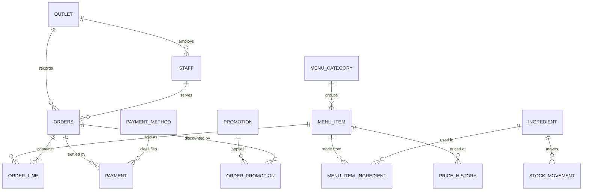

# Restaurant Order and Sales Tracking System (ROSTS)

**Student:** Queen Ineza · **Student ID:** 29354
**Course:** INSY 8311 – Database Development with PL/SQL · **Instructor:** Eric Maniraguha
**Institution:** Adventist University of Central Africa (AUCA) · **Academic year:** 2026–2027, Semester I
**Phase 0 deliverable:** research log, data source, proposal, presentation

ROSTS is a relational Oracle database with all business logic written in PL/SQL: it takes a
customer order, prices every line from the menu, computes the bill and its tax, records the
payment against that receipt, deducts the ingredients the kitchen consumed, refuses any
operation that breaks a restaurant rule, writes an audit trail, and answers the manager's
daily questions (revenue, best sellers, payment mix, low stock) from SQL instead of a
spreadsheet. The interactive layer (innovation) is an Oracle APEX application, the
**ROSTS Console**.

---

## 1. Problem

Rwanda's food service sector is large and overwhelmingly small-scale. The 2023
Establishment Census counted 269,326 establishments, of which accommodation and food
service activities are 23.0 % — the second largest activity after wholesale and retail trade —
and the same activity employs 12.9 % of the country's 927,739 workers (National Institute of
Statistics of Rwanda [NISR], 2024). Almost all of these businesses are micro-enterprises:
92.2 % employ fewer than four workers (NISR, 2024).

At that size, order taking is manual. A waiter writes on a pad, the cashier re-adds the bill
by hand, the mobile-money message and the cash drawer are reconciled at closing time, and
stock is counted once a week "by eye". The consequences are operational, not strategic:

1. **Bills are arithmetic done by a person under time pressure.** A re-added bill is a
   dispute with the customer and a discount nobody authorised.
2. **Payment and order live in two different places.** A receipt paid by mobile money but
   written on a pad cannot be matched to the order, so the day's cash-up does not balance
   and the gap is absorbed silently — revenue leakage.
3. **Ingredient stock is not connected to sales.** A sold cappuccino is two shots of coffee
   and 200 ml of milk, but the shop discovers it has run out of milk at 12:30, during the
   lunch peak, or throws away milk that was over-ordered. Perishable stock needs
   per-sale consumption, not a weekly count.
4. **No audit trail.** A changed price, a deleted order or a 50 % "manager discount" leaves
   no trace and cannot be attributed to a staff member.
5. **No reliable sales reporting.** Without a database, "which item earns the most", "which
   hour needs a second cashier" and "how much did we sell last Tuesday" are answered by
   memory.

The literature says the same thing from the other side. In a survey of 385 restaurant
employees, staff in restaurants running a management system reported easier operations,
higher sales and more standard service, but every group rated the technical cost of such
systems as high, and the least positive responses came from restaurants with ten or fewer
staff (Memis Kocaman, 2021). The benefit is real; the barrier is cost and complexity. For
an inventory system designed for a single restaurant, the authors conclude the design must
follow the restaurant's own six-phase process and its perishable stock, or it will not be used
(Zamora Saltos & Rodríguez Borges, 2024). A database-centred design — one schema, logic in
the database, a free browser interface — attacks exactly that barrier: it needs no licence per
terminal and no separate application server.

## 2. Solution

One Oracle pluggable database (`ROSTS_PDB`) holding fifteen normalised tables and all the
rules as PL/SQL, so a wrong state cannot be stored no matter which client writes:

- **Order capture and billing in the database.** `sp_place_order` inserts the receipt header
  and its lines in one transaction; a trigger prices each line from `MENU_ITEM.unit_price`,
  a function computes net, tax and total, and the header is updated from its own lines. The
  cashier's screen never computes a total.
- **Stock moves because a sale happened.** After each order line, a trigger writes a
  `STOCK_MOVEMENT` row and decrements `INGREDIENT.qty_on_hand` through the recipe table
  `MENU_ITEM_INGREDIENT`. If the ingredient on hand cannot cover the line, the trigger raises
  `-20001` and the whole order is rolled back — the shop cannot sell what it does not have.
- **Payment rules enforced, not advised.** `sp_record_payment` inserts the payment against
  the receipt; triggers refuse a payment on a cancelled order (`-20003`), a payment that
  would exceed the bill (`-20004`), and any edit to an order that is already paid
  (`-20002`). An order cannot move to `CLOSED` while its paid amount is below its total.
- **Discounts are bounded.** A promotion above 20 % requires a `MANAGER` role; otherwise
  `-20005`.
- **Everything sensitive is audited.** `AUDIT_LOG` receives the old and new value, the
  database user and the timestamp for price changes, deletions and refused operations.
- **Reporting is SQL.** `fn_daily_revenue`, a monthly sales cursor, a top-items ranking
  cursor and a low-stock cursor feed the manager views (`v_daily_sales`, `v_top_items`,
  `v_low_stock`), which the APEX dashboard reads directly.

## 3. Data source

| Item | Detail |
| --- | --- |
| Dataset | Anonymous Transactional Dataset, version 2 |
| Authors | Engel, Gaol, Kurniawan & Budiharto (2026) |
| Publisher / DOI | Mendeley Data (Elsevier) · `10.17632/kcgf45y24m.2` |
| What it is | Real point-of-sale receipts from a food-and-beverage micro/small enterprise running **three outlets**, 2 January – 30 September 2025: 53,820 receipts, 96 menu products, 3 payment methods (`BCA` 42,805 · `Cash` 10,913 · `GoFood` 102), net sales, 11 % tax and total per receipt |
| Licence | CC BY 4.0 — reuse and adaptation with attribution |
| Personal data | None. There is no customer name, phone or card number; the only customer field is a 0/1 loyalty-card flag, and outlet codes are `SHOP001`–`SHOP003` |
| Loaded in this repository | `data/raw/pos_shop001_2025-01-0{2..7}.csv` — 550 receipts, outlet `SHOP001`, 2–7 January 2025, 13,542,000 total, one CSV per trading day (the assignment asks for a few hundred records); `data/raw/products_catalog.csv` — the 96-product catalogue |
| Derived, and disclosed | The source has receipts and products but no recipes, no ingredient stock and no staff table. `INGREDIENT`, `MENU_ITEM_INGREDIENT`, `STOCK_MOVEMENT` and `STAFF` will be **derived sample data** built on top of the real receipts and labelled `record_source = 'DERIVED'`. See `data/README.md`. |

The real receipts give the system its hard facts: receipt numbers (`SHOP001JAN2500001`),
timestamps, item names such as `Basic Latte (Ice Arabica)`, quantities, 11 % tax, totals and
payment method. Everything the database asserts about money is checked against them.

## 4. Planned tables (3NF, 15 tables)

| # | Table | Purpose |
| --- | --- | --- |
| 1 | `OUTLET` | The three shops: code, name, city, opening date, active flag |
| 2 | `STAFF` | Cashiers, baristas, managers: outlet, role, hire date, active |
| 3 | `MENU_CATEGORY` | Coffee, non-coffee, tea, add-on, food, merchandise |
| 4 | `MENU_ITEM` | One row per sellable product and variant, with unit price |
| 5 | `PRICE_HISTORY` | Every price change with who changed it and why |
| 6 | `INGREDIENT` | Raw stock (beans, milk, syrup, cups): unit, quantity on hand, reorder level |
| 7 | `MENU_ITEM_INGREDIENT` | Recipe: how much of each ingredient one unit of an item consumes |
| 8 | `PAYMENT_METHOD` | `CASH`, `BCA`, and any method added later, with an is-cash flag |
| 9 | `ORDERS` | Receipt header: outlet, staff, timestamp, status, net, tax, total |
| 10 | `ORDER_LINE` | Line item: product, quantity, unit price captured at sale time, line total |
| 11 | `PAYMENT` | Money received against one receipt: method, amount, time, status |
| 12 | `STOCK_MOVEMENT` | Every ingredient in/out, linked to the order that consumed it |
| 13 | `PROMOTION` | Named discount with percentage and validity window |
| 14 | `ORDER_PROMOTION` | Which promotion was applied to which receipt, and the amount |
| 15 | `AUDIT_LOG` | Old/new value, action, table, record key, database user, timestamp |



The source receipt is one flat row (`ReceiptNumber`, `Items`, `TotalItem`, `NetSales`,
`Tax`, `TotalAmount`, `PaymentMethod`); Phase II splits it into `ORDERS` → `ORDER_LINE` →
`PAYMENT` and resolves each free-text item name against `MENU_ITEM`.

## 5. Planned PL/SQL features

| Feature | Where it is used |
| --- | --- |
| Procedures | `sp_place_order`, `sp_add_order_line`, `sp_record_payment`, `sp_close_order`, `sp_apply_promotion`, `sp_change_price`, `sp_adjust_stock` |
| Functions | `fn_item_price`, `fn_line_total`, `fn_order_tax`, `fn_order_total`, `fn_stock_available`, `fn_daily_revenue`, `fn_payment_balance` |
| Explicit cursors | Monthly sales ranking, low-stock alert list, daily cash-up by payment method; a `FOR UPDATE` cursor guards stock deduction |
| Package | `pkg_rosts_ops` (specification + body): order, billing, inventory, reporting subprograms, with private helpers |
| Triggers | `trg_line_price` (price a line from the menu, refuse negative quantity), `trg_line_stock` (write `STOCK_MOVEMENT`, decrement `INGREDIENT`, raise `-20001`), `trg_order_totals` (recompute totals from lines, block edits on a paid order `-20002`), `trg_payment_guard` (`-20003`, `-20004`), `trg_price_audit` (price change → `PRICE_HISTORY` + `AUDIT_LOG`), `trg_order_audit` (delete → `AUDIT_LOG`) |
| Restriction rule | A discount above 20 % requires the `MANAGER` role (`-20005`); no order may close while `fn_payment_balance > 0`; stock may not go negative |
| Exception handling | Named exceptions for each rule, `RAISE_APPLICATION_ERROR` with a message the APEX page shows verbatim, `SAVEPOINT`/`ROLLBACK` per order, `NO_DATA_FOUND` and `DUP_VAL_ON_INDEX` handled in the package |
| Views for the innovation layer | `v_daily_sales`, `v_top_items`, `v_low_stock`, `v_audit_recent` |

## 6. Innovation

**Option chosen: user interface — Oracle APEX.** The database is not the innovation; the
usable layer on top of it is. `ROSTS Console` gives a cashier a single order screen with
product buttons that calls `sp_place_order` and prints the computed bill, a payment screen
that calls `sp_record_payment`, and gives a manager an APEX dashboard built on the views
above: revenue per outlet per day, best-selling items, payment mix, a low-stock alert badge
and a read-only audit log. Every rule stays in PL/SQL — the pages only call it — so a page
cannot be edited into an inconsistency. Details in `docs/innovation/innovation.md`.

## 7. Repository structure

```
Queen_29354_restaurent/
├── README.md
├── data/
│   ├── README.md                      provenance, licence, subset rule, checksums
│   └── raw/
│       ├── pos_shop001_2025-01-02.csv … -01-07.csv       550 real receipts, one CSV per day
│       └── products_catalog.csv                          96 real products
├── docs/
│   ├── research/research_log.md       six verified sources, type, finding, gap
│   ├── proposal/proposal.md           the 2-page proposal
│   ├── proposal/proposal.docx         same text, formatted as submitted
│   ├── presentation/phase0_slides.md  12 slides
│   └── innovation/innovation.md       APEX plan
└── tools/make_proposal_docx.ps1       rebuilds proposal.docx from proposal.md
```

## 8. Phase 0 checklist

- [x] Original problem, not a banned topic (no student, hospital or employee management)
- [x] Research log with six verified sources: 2 papers, 1 official statistic, 1 existing
      system, 1 dataset, 1 technical reference — every link opened and read
- [x] Real dataset, openly licensed (CC BY 4.0), no personal data, a few hundred records
      committed to `data/raw/`
- [x] Two-page proposal with title, problem, solution, data source, planned tables, planned
      PL/SQL features, innovation and APA references
- [x] Twelve-slide Phase 0 deck
- [x] Innovation option and tool named (user interface — Oracle APEX)
- [ ] Phase I business process model (BPMN / UML swimlane) — next phase
- [ ] GitHub repository renamed to the `firstname_studentID_projectShortName` pattern if the
      instructor requires it; the current name is `Queen_29354_restaurent`

## References

Engel, M. M., Gaol, F. L., Kurniawan, A., & Budiharto, W. (2026). *Anonymous transactional
dataset* (Version 2) [Data set]. Mendeley Data.
https://doi.org/10.17632/kcgf45y24m.2

Memis Kocaman, E. (2021). Operational effects of using restaurant management system: An
assessment according to business features. *International Journal of Gastronomy and Food
Science, 25*, 100408. https://doi.org/10.1016/j.ijgfs.2021.100408

National Institute of Statistics of Rwanda. (2024). *Establishment Census 2023*.
https://statistics.gov.rw/data-sources/censuses/Establishment-Census/establishment-census-2023

Oracle. (2026a). *CREATE TRIGGER statement* (Oracle Database 19c PL/SQL Language
Reference). https://docs.oracle.com/en/database/oracle/oracle-database/19/lnpls/CREATE-TRIGGER-statement.html

Oracle. (2026b). *Oracle Simphony restaurant POS system*.
https://www.oracle.com/food-beverage/restaurant-pos-systems/

Zamora Saltos, C. E., & Rodríguez Borges, C. G. (2024). Design of an inventory management
system for a Manabita restaurant. *InGenio, 7*(2).
https://doi.org/10.18779/ingenio.v7i2.808
